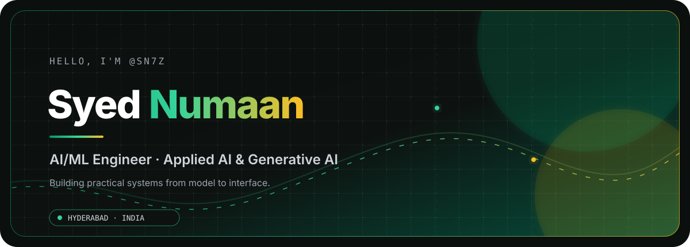
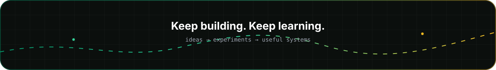

<p align="center">
  
</p>

<p align="center">
  <a href="https://github.com/sn7z"></a>
  <a href="https://www.linkedin.com/in/syed-numaan-22a2b52ab/"></a>
  <a href="mailto:syednumaan15@gmail.com"></a>
  <a href="https://syed-numaan-portfolio.vercel.app/"></a>
</p>

<p align="center">
  <em>Applied AI · Generative AI · Explainable ML · Product-minded engineering</em>
</p>

<p align="center">
  <a href="#about">About</a> ·
  <a href="#featured-work">Projects</a> ·
  <a href="#toolkit">Toolkit</a> ·
  <a href="#credentials--milestones">Credentials</a> ·
  <a href="#connect">Connect</a>
</p>


## About

I’m **Syed Numaan**, an AI/ML Engineer from Hyderabad, India, focused on turning technical ideas into useful products. My work sits at the intersection of machine learning, deep learning, generative AI, backend systems, and clear user experiences.

I’m currently pursuing a **B.E. in Computer Science & Engineering (AI & ML)** at Lords Institute of Engineering & Technology (2022–2026). I enjoy building from the model layer to the interface: multimodal detection, knowledge graphs, RAG assistants, AI agents, and social-impact software.

<table>
  <tr>
    <td align="center" width="25%"><strong>01</strong><br /><sub>Applied AI</sub></td>
    <td align="center" width="25%"><strong>02</strong><br /><sub>Generative AI</sub></td>
    <td align="center" width="25%"><strong>03</strong><br /><sub>Explainable ML</sub></td>
    <td align="center" width="25%"><strong>04</strong><br /><sub>Human-centered products</sub></td>
  </tr>
</table>

```text
focus/
├── applied-ai       → practical systems with a clear user outcome
├── genai-and-rag    → grounded assistants, retrieval, and agent workflows
├── explainability   → evidence alongside predictions
└── deployment       → usable interfaces and maintainable backends
```

## How I Build

```text
signal          → understand the real problem
architecture    → choose the simplest useful system
intelligence   → train, retrieve, reason, or orchestrate
interface       → make the result clear and usable
iteration       → test assumptions and improve the edges
```

<p align="center">
  <sub>From model output to a product someone can actually use.</sub>
</p>

## Featured Work

Three projects that best represent how I build: useful, explainable, and human-centered.

<table>
  <tr>
    <td width="33%" valign="top">
      <h3>DeepSense</h3>
      <p><strong>Explainable multimodal deepfake detection</strong></p>
      <p>Detects manipulated images, audio, and video with model-specific evidence: Grad-CAM heatmaps, spectral analysis, and plain-language forensic explanations.</p>
      <sub>Python · TensorFlow/Keras · Streamlit · Gemini · XAI</sub>
      <br /><br />
      <a href="https://github.com/sn7z/DeepSense">Repository</a> ·
      <a href="https://ijesr.org/index.php/ijesr/article/view/1636">Publication</a>
    </td>
    <td width="33%" valign="top">
      <h3>MindCanvas</h3>
      <p><strong>AI knowledge graph for the web</strong></p>
      <p>Turns browsing content into a searchable knowledge network with topic extraction, relationship mapping, semantic search, RAG chat, and a Chrome extension.</p>
      <sub>React · FastAPI · Supabase/pgvector · LangChain · Cytoscape.js</sub>
      <br /><br />
      <a href="https://github.com/sn7z/MindCanvas">Repository</a>
    </td>
    <td width="33%" valign="top">
      <h3>H.E.A.R.</h3>
      <p><strong>Harassment Evaluation and Action Response</strong></p>
      <p>A social-impact platform for incident reporting, awareness resources, AI-assisted support through Saheli, and emergency-help features.</p>
      <sub>React · Tailwind CSS · Node.js/Express · MySQL · LangChain/OpenAI</sub>
      <br /><br />
      <a href="https://github.com/sn7z/H.E.A.R">Repository</a>
    </td>
  </tr>
</table>

<details>
<summary><strong>More work</strong></summary>
<br />

- **[DEV-Agent](https://github.com/sn7z/DEV-Agent)** — an LLM-driven engineering workflow that turns a natural-language prompt into a plan and iteratively implements it with tool-enabled coder agents.
- **[Multi-Modal-RAG](https://github.com/sn7z/Multi-Modal-RAG)** — a Streamlit RAG assistant for PDFs, text, Markdown, and web URLs with source attribution.
- **[KidsCare-Pro](https://github.com/sn7z/KidsCare-Pro)** — a child-health management and prediction platform concept with profiles, milestones, appointments, and dashboards.

</details>

## Experience & Education

<table>
  <tr>
    <td width="22%" valign="top"><strong>2024</strong></td>
    <td><strong>Machine Learning Engineer Intern · Ram Technologies</strong><br /><sub>Virtual internship focused on machine-learning prediction tasks.</sub></td>
  </tr>
  <tr>
    <td width="22%" valign="top"><strong>2022 — 2026</strong></td>
    <td><strong>B.E. Computer Science & Engineering (AI & ML)</strong><br /><sub>Lords Institute of Engineering & Technology · Hyderabad, India</sub></td>
  </tr>
  <tr>
    <td width="22%" valign="top"><strong>April 2025</strong></td>
    <td><strong>Code2Skill · First Prize</strong><br /><sub>LIET Microsoft Students Club competition powered by HackerRank.</sub></td>
  </tr>
</table>

## Toolkit

<table>
  <tr>
    <td><strong>Languages</strong><br />Python · Java · C · C++ · SQL · JavaScript · HTML · CSS</td>
    <td><strong>ML & data</strong><br />scikit-learn · NumPy · Pandas · Matplotlib · Plotly · seaborn</td>
  </tr>
  <tr>
    <td><strong>Deep learning</strong><br />TensorFlow · PyTorch · Keras · OpenCV · YOLO</td>
    <td><strong>GenAI & agents</strong><br />LangChain · LangGraph · LlamaIndex · CrewAI · RAG</td>
  </tr>
  <tr>
    <td><strong>Apps & backend</strong><br />React · FastAPI · Flask · Streamlit · REST APIs</td>
    <td><strong>Data & workflow</strong><br />MySQL · Supabase · SQLite · ChromaDB · FAISS · GitHub Actions</td>
  </tr>
</table>

<details>
<summary><strong>What I reach for first</strong></summary>
<br />

| Need | Starting point |
| --- | --- |
| Predictive modelling | Python · scikit-learn · Pandas |
| Deep learning | TensorFlow/Keras · PyTorch · OpenCV |
| Grounded generation | LangChain · LangGraph · RAG · vector stores |
| Product interface | React · FastAPI · Streamlit |
| Delivery and collaboration | Git · GitHub · GitHub Actions |

</details>

## Credentials & Milestones

The following are listed in my portfolio and supporting project records:

- **Oracle Cloud Infrastructure 2025 Certified Generative AI Professional** — credential ID `102918478OCI25GAIOCP`
- **Columbia University — AI-II online course** — credential ID `161188123`
- **HP — Data Science and Analytics course** — credential ID `9005d1b9-e02c-4826-8054-e1798f56fcb0`
- **AWS Solutions Architect** — certificate image listed in my portfolio; credential type/status is intentionally not overstated here
- **Code2Skill — First Prize** — LIET Microsoft Students Club competition powered by HackerRank, April 2025

> Certificate images and the latest credential details are maintained in the [portfolio repository](https://github.com/sn7z/Portfolio). No third-party credential URLs are added here unless publicly verified.

## Build Notes

<table>
  <tr>
    <td width="50%" valign="top">
      <strong>What matters to me</strong><br /><br />
      Clear interfaces, grounded answers, useful explanations, and systems that respect the people using them.
    </td>
    <td width="50%" valign="top">
      <strong>What I’m exploring</strong><br /><br />
      Applied generative AI, agent workflows, explainable multimodal systems, and reliable deployment patterns.
    </td>
  </tr>
</table>

## GitHub Contributions

<p align="center">
  <a href="https://github.com/sn7z/snk">
    
  </a>
</p>

<p align="center">
  <sub>Contribution activity is rendered by my <a href="https://github.com/sn7z/snk">snk</a> workflow.</sub>
</p>

## Connect

I’m open to connecting with people working on AI/ML, generative AI, and practical software projects.

<p>
  <a href="mailto:syednumaan15@gmail.com">✉️ Email</a> ·
  <a href="https://www.linkedin.com/in/syed-numaan-22a2b52ab/">LinkedIn</a> ·
  <a href="https://leetcode.com/u/syednumaan15/">LeetCode</a> ·
  <a href="https://syed-numaan-portfolio.vercel.app/">Portfolio</a>
</p>

<p align="center">
  
</p>
