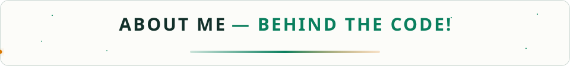
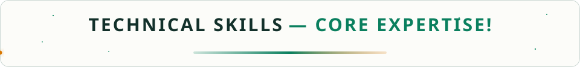
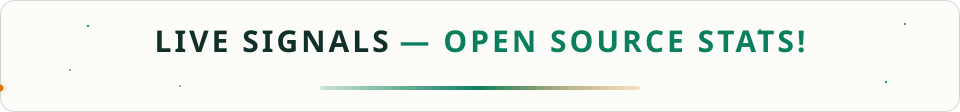
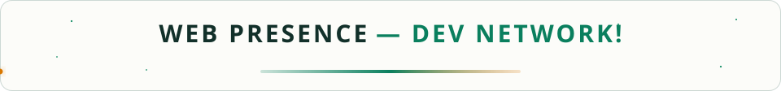
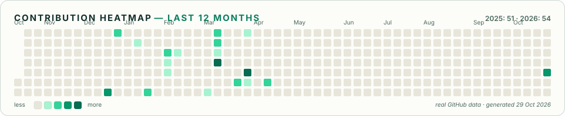

  <picture>
    <source media="(prefers-color-scheme: dark)" srcset="./assets/hero-dark.svg" />
    
  </picture>

  
  
  
  

  <em>Ideate. Design. Develop. Innovate.</em>

  <picture>
    <source media="(prefers-color-scheme: dark)" srcset="./assets/titles/about-dark.svg" />
    
  </picture>

  <strong>AI/ML Engineer</strong> focused on Applied AI and Generative AI. 
  I build practical AI systems from model to interface — useful experiences, explainable results, reliable engineering.

  Hyderabad, India · Open to collaboration

  <picture>
    <source media="(prefers-color-scheme: dark)" srcset="./assets/titles/skills-dark.svg" />
    
  </picture>

<strong>Languages</strong>

  
  
  
  
  
  
  
  

<strong>ML &amp; Data · DL &amp; CV</strong>

  
  
  
  
  
  
  
  
  
  
  

<strong>GenAI &amp; Agents</strong>

  
  
  
  
  

<strong>Backend · Frontend · Databases · Tools</strong>

  
  
  
  
  
  
  
  
  
  
  
  
  

  <picture>
    <source media="(prefers-color-scheme: dark)" srcset="./assets/titles/certifications-dark.svg" />
    
  </picture>

| Milestone | Details |
| --- | --- |
| 🥇 **Code2Skill — First Prize** | Coding competition, LIET Microsoft Students Club × HackerRank · *April 2025* |
| 🟢 **Oracle OCI 2025 Certified Generative AI Professional** | LLM foundations, prompt engineering, RAG on OCI · ID `102918478OCI25GAIOCP` |
| 🟢 **Columbia University — Artificial Intelligence II (Columbia+)** | Applied AI and ML methods · ID `161188123` |
| 🟢 **HP — Data Science and Analytics Course** | Data analysis workflows and practical analytics |
| 🟢 **AWS Solutions Architect (Trained)** | Compute, storage, networking and resilient cloud design |

  <picture>
    <source media="(prefers-color-scheme: dark)" srcset="./assets/titles/stats-dark.svg" />
    
  </picture>

  <picture>
    <source media="(prefers-color-scheme: dark)" srcset="https://streak-stats.demolab.com?user=sn7z&hide_border=true&background=0D1210&border=064E3B&borderRadius=10&ring=34D399&fire=34D399&currStreakLabel=34D399&currStreakNum=FFFFFF&sideNums=D1D5DB&sideLabels=9CA3AF&dates=6B7280" />
    <source media="(prefers-color-scheme: light)" srcset="https://streak-stats.demolab.com?user=sn7z&hide_border=true&background=F5F3EA&border=10A05B&borderRadius=10&ring=0A7F5E&fire=D97706&currStreakLabel=0A7F5E&currStreakNum=12302A&sideNums=2B4A3E&sideLabels=476559&dates=6B7280" />
    
  </picture>
  

<!-- 

  
  
  

 -->

<!-- 

  <picture>
    <source media="(prefers-color-scheme: dark)" srcset="./assets/titles/connect-dark.svg" />
    
  </picture>

<!-- 

  <a href="https://syed-numaan-portfolio.vercel.app/"><strong>Portfolio</strong></a> ·
  <a href="https://www.linkedin.com/in/syed-numaan-22a2b52ab/"><strong>LinkedIn</strong></a> ·
  <a href="https://github.com/sn7z"><strong>GitHub</strong></a> ·
  <a href="https://leetcode.com/u/syednumaan15/"><strong>LeetCode</strong></a>

  🎮 Off the clock — <a href="https://syed-numaan-portfolio.vercel.app/#bug-hunt">play <strong>Bug Hunt</strong></a> and chat with <a href="https://syed-numaan-portfolio.vercel.app/#chat"><strong>Ask My AI</strong></a>, live on the portfolio.

  <picture>
    <source media="(prefers-color-scheme: dark)" srcset="./assets/heatmap-dark.svg" />
    
  </picture>

 --> 

  <picture>
    <source media="(prefers-color-scheme: dark)" srcset="./assets/footer-dark.svg" />
    
  </picture>

